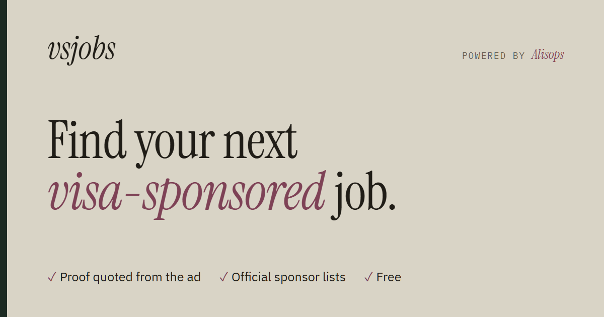
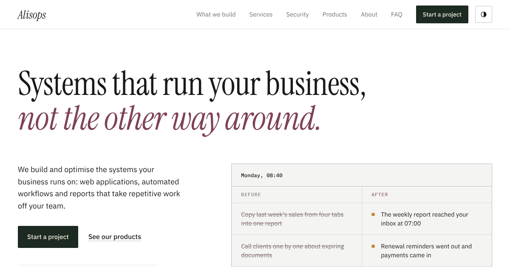

  
  
  
  

---

## 👋 About Me

I'm **Praise Taiwo**, founder of **[Alisops](https://alisops.xyz)**. I build and optimise the systems businesses run on: **web applications, automated workflows and data pipelines** that take repetitive work off a team.

I work end to end. I map how the work gets done today, build it in the client's own accounts, test it against real data and hand it over documented. Security is part of every build: least-privilege access, minimal personal data and a clean handover.

<table>
  <tr>
    <td width="33%" valign="top">
      <h4>🧩 Web applications</h4>
      Custom apps, client portals, renewals and online payments, built around how a business actually works.
    </td>
    <td width="33%" valign="top">
      <h4>⚙️ Automation</h4>
      Order intake, approvals, reminders and alerts that move to the next step on their own.
    </td>
    <td width="33%" valign="top">
      <h4>📊 Data & reporting</h4>
      Pipelines, warehouses and dashboards with one agreed definition for every number.
    </td>
  </tr>
</table>

---

## 🚀 Products I've Built

> These are live, so you can try them now. Source code for client work and most products is kept private to protect client and user data.

<table>
  <tr>
    <td width="50%" valign="top">
      
      <h3><a href="https://vsjobs.alisops.xyz">vsjobs</a></h3>
      
      
      
<b>Visa-sponsored jobs, with proof.</b> An AI-assisted job search that tells you whether an employer will sponsor your visa before you apply.

      <ul>
        <li>Labels every job by country and quotes the sentence from the ad that decided it</li>
        <li>Cross-checks employers against official sponsor registers (UK, US, CA, NL, IE, DK)</li>
        <li>Rules-first classifier; an LLM reviews only the ads the rules can't decide, and its quote is verified word for word</li>
        <li>Pulls from 8 ATS systems across 50+ countries and refreshes every 6 hours, all on free tiers</li>
      </ul>
      

        
        
        
        
        
        
      

      <a href="https://vsjobs.alisops.xyz"><b>Open vsjobs →</b></a>
    </td>
    <td width="50%" valign="top">
      
      <h3><a href="https://alisops.xyz">Alisops</a></h3>
      
      
      
<b>Systems that run your business, not the other way around.</b> My company. We build web apps, client portals, workflow automation and reporting for businesses of every size.

      <ul>
        <li>Fast static site with light, dark and "paper" themes, built on a documented brand system</li>
        <li>Project intake runs through Google Apps Script: each request is logged to a sheet and sends an email notification</li>
        <li>Hosts the product catalogue: web apps plus free Google Sheets templates</li>
        <li>Security-first delivery process: NDA, named MFA logins, access closed off at handover</li>
      </ul>
      

        
        
        
        
        
      

      <a href="https://alisops.xyz"><b>Visit alisops.xyz →</b></a>
    </td>
  </tr>
</table>

<table>
  <tr>
    <td width="33%" valign="top">
      <h3><a href="https://dhc.alisops.xyz">Domain Health Checker</a></h3>
      
      
      
<b>Will Google and Yahoo trust your email?</b> Enter a domain to get a live SPF and DMARC check, then a plain-English explanation of what's missing. No sign-up.

      

        
        
      

      <a href="https://dhc.alisops.xyz"><b>Check your domain →</b></a>
    </td>
    <td width="33%" valign="top">
      <h3><a href="https://alisops.xyz/#templates">Invoice Flow</a></h3>
      
      
      
<b>Branded invoices and a shareable order form.</b> Customers order through a link, a branded invoice is created, you're notified and every order is logged.

      

        
        
      

      <a href="https://alisops.xyz/#templates"><b>Get Invoice Flow →</b></a>
    </td>
    <td width="33%" valign="top">
      <h3><a href="https://alisops.xyz/#templates">Stock Watch</a></h3>
      
      
      
<b>Inventory tracking with a live dashboard.</b> A daily low-stock email, grouped by supplier, with suggested order quantities.

      

        
        
      

      <a href="https://alisops.xyz/#templates"><b>Get Stock Watch →</b></a>
    </td>
  </tr>
</table>

<b>Earlier work</b>

 

| Project | What it is | Built with |
|:--|:--|:--|
| [JustDice Financial Performance Report](https://github.com/praisino/JustDice-Financial-Performance-Report-2022) | Analysis of a year of ad spend, installs, payouts and revenue to find trends and optimisation areas | Python, pandas, Jupyter |
| [Celo Marketplace dApp](https://github.com/praisino/Marketplace-Celo-Dapp) | Decentralised marketplace with a smart contract on the Celo testnet | Solidity, JavaScript |
| [Django apps](https://github.com/praisino/zuri-django-apps) | Backend projects from the Zuri training programme | Python, Django |

---

## 🛠️ Tech Stack

<table>
  <tr>
    <td width="150"><b>Languages</b></td>
    <td></td>
  </tr>
  <tr>
    <td><b>Web & backend</b></td>
    <td></td>
  </tr>
  <tr>
    <td><b>Databases</b></td>
    <td></td>
  </tr>
  <tr>
    <td><b>Cloud & DevOps</b></td>
    <td></td>
  </tr>
  <tr>
    <td><b>Data & BI</b></td>
    <td>
      
      
      
      
      
      
      
    </td>
  </tr>
  <tr>
    <td><b>Automation & ops</b></td>
    <td>
      
      
      
      
      
    </td>
  </tr>
</table>

---

## 📊 GitHub Stats

### 📈 Contribution Activity

Stats are generated daily by a GitHub Action in this repo. Much of my work is in private repositories, so public numbers show only part of it.

---

### 🤝 Need a system built?

Tell me which task eats up your team's Monday.

